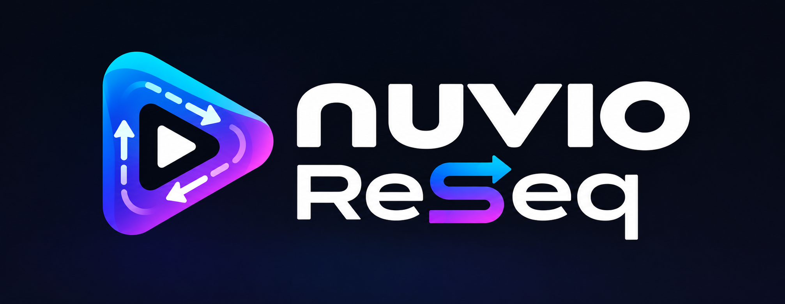

<p align="center">
  
</p>

# Nuvio ReSeq

Nuvio ReSeq is an independent Android TV fork of [Nuvio](https://github.com/NuvioMedia/NuvioTV), adding TheTVDB episode ordering while keeping Nuvio’s addons, playback and tracking integrations.

**[Download the latest APK](https://github.com/abbaskip/Nuvio-ReSeq/releases/latest)** · [All releases](https://github.com/abbaskip/Nuvio-ReSeq/releases) · [Report an issue](https://github.com/abbaskip/Nuvio-ReSeq/issues)

## Choose the episode order that matches your sources

Open a series and select **Episode order**:

- **Default / Metadata Provider** keeps the original metadata provider’s episodes and normal Nuvio behaviour.
- **TVDB Standard / Aired** uses TVDB’s standard listing.
- Other TVDB orders are offered when available for that series, including DVD, absolute and alternate orders. The available names come from TVDB.

The season and episode number you see is the number sent to streaming addons. For example, selecting Alternate **S05E03 — Business Ethics** searches for **S05E03**, even though its standard identity is **S05E02**. Choose the returned stream that matches your intended episode; ReSeq does not inspect filenames or filter editions for you.

Tracking is separate from stream searching. Verified episode correspondence connects watched status, scrobbling, progress and resume to the underlying episode identities used by Nuvio, Trakt, Simkl and MDBList. Your selected tracking sources still control watched indicators and Continue Watching. Verified correspondences can span series that different catalogues organise differently.

For known split/combined episodes, progress can be projected onto verified underlying episodes. Known runtimes are used where available; otherwise part boundaries are proportional estimates. Local resume keeps the exact video position. Extended cuts of ordinary episodes use the playing video’s actual duration. Existing **Reuse Last Link** continues to identify the underlying episode across order changes.

## Set up TheTVDB

1. Visit [TheTVDB’s API information page](https://thetvdb.com/api-information) to obtain an API v4 key with suitable access. Access is subject to TheTVDB’s terms and may require a subscription or licence.
2. In ReSeq, open **Settings → Integrations → TheTVDB** for the profile you use.
3. Enter your own key, save it and select **Test connection**.
4. Open a series and choose its episode order.

Keys and order selections are profile-specific. No personal TVDB key is included in the APK. Default / Metadata Provider works without one.

Metadata provided by [TheTVDB](https://thetvdb.com). Please consider contributing missing information or subscribing.

## Install and update

Download the **universal APK** from this repository’s [GitHub Releases](https://github.com/abbaskip/Nuvio-ReSeq/releases/latest), transfer it to your Android TV device and allow installation from your chosen installer. Android 7.0 or later is required. Release pages include a SHA-256 checksum.

ReSeq installs alongside official Nuvio and existing Nuvio Debug installations. Its permanent package ID is `io.github.abbaskip.nuvioreseq`. Settings and login sessions are separate; signing into the same Nuvio account can restore supported cloud data, but device settings, TVDB credentials/order selections and some integration logins require setup again.

In-app updates check **only this repository**. There is one release channel: versions labelled beta are published as ordinary GitHub Releases. Install future signed ReSeq releases over the existing app to retain its data. Do not uninstall first.

## Beta limitations

- TVDB coverage, artwork and episode correspondence vary. Missing or ambiguous identities are not guessed for tracking. Some episodes may therefore have limited tracking or resume support.
- A combined video’s estimated split point may not match its actual scene boundary. Cross-device resume recovers the best available native-episode position; exact local resume is retained.
- Switching cuts may change the meaning of a saved timestamp. Stream addons use different numbering conventions; selecting an order does not guarantee every returned stream matches it.
- ReSeq does not supply media. Bring your own addons and sources. External services have their own availability, account and API requirements.

## Build from source

Use Android Studio, JDK 21 and the Android SDK. Copy `local.example.properties` to the ignored `local.properties` and supply your own application configuration. Credentials are not included in this repository. For the bundled FFmpeg decoder, a debug build is:

```sh
./gradlew :app:assembleFullDebug -PuseLocalFfmpegDecoder=false
```

Debug builds have a separate package ID. Signed releases require a private keystore and the `NUVIO_RELEASE_STORE_FILE`, `NUVIO_RELEASE_KEY_ALIAS`, `NUVIO_RELEASE_STORE_PASSWORD` and `NUVIO_RELEASE_KEY_PASSWORD` environment variables (or ignored local properties). Public ReSeq APKs use a permanent release certificate. Build configuration embedded in an APK is extractable; never supply personal account tokens or confidential backend credentials.

## Credits and licence

Nuvio ReSeq is maintained by [abbaskip](https://github.com/abbaskip). It is based on [Nuvio by Tapframe and contributors](https://github.com/NuvioMedia/NuvioTV), whose work makes this fork possible. It is an independent fork and is not an official Nuvio release.

Source code is distributed under the [GNU General Public License v3.0](LICENSE). Existing third-party notices and in-app licences are retained. TheTVDB, TMDB, Trakt, Simkl, MDBList and other services retain their respective names, data rights and terms; their use does not imply endorsement.
