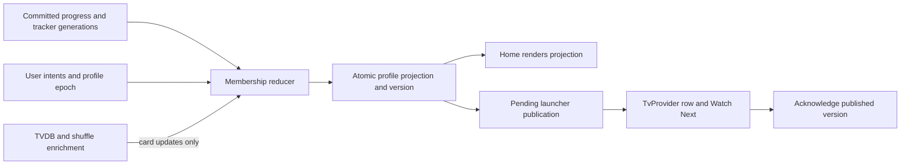

# Stability programme: Phase 2 design and work plan

**Status: Phase 2 approved with the amendments recorded below. B0 only is
authorized; implementation must wait for explicit Phase 3 base confirmation.**
Phase 1 and its corrected findings remain approved. This design change touches
only this document. All component names, limits and tests below are proposals,
unless explicitly identified as existing code or measured evidence.

## 1. Evidence, scope and base

Design reference: published beta **9.6.1**, build **10051**, application source
`c2b4d94f32372446fedb24ee951d0a026ddd4e1f`, with approved Phase 1 evidence at
`bf3b0c45f6e66a6032529acf11e80bd6d6a600cc`. The isolated documentation branch is
`codex/stability-phase2-design`, based on that Phase 1 checkpoint. PR #14 remains
the Phase 1 branch; unrelated working-tree changes are excluded.

Primary evidence: [DISCOVERY.md](DISCOVERY.md),
[measurements](phase1-measurements.json), and
[source inventory](static-inventory.json). DISCOVERY's historical “awaiting
approval” statement is superseded by the maintainer's approval recorded here;
the Phase 1 report itself is preserved.

| Priority | Established evidence | Design decision |
| --- | --- | --- |
| CW membership and consumers | Three cards survived the five-minute cold start. After synthetic completion, an unresolved ordered card disappeared, and the sequential control's snapshot and actual launcher intent remained on S1E1 instead of S1E2 off Home and after Home return. | Separate durable membership/projection from visible-Home enrichment. One owner authorizes removal; all consumers use one versioned projection. |
| Allocator | Corrected local and CI suites: 91 passed, 3 failed, 13 skipped. Two late-release footprint assertions fail alone; arena membership fails in the suite but passed alone. | Correct the demonstrated test-contract/isolation assumptions through reviewed tests; independently establish native reclamation and real-player teardown correctness before declaring the engine healthy. A1 blocks player/allocator/NNTP/memory releases; CW and policy releases require no-worse allocator results with A1 in progress. No skips or quarantine. |
| Work priority | Import parked a quiet worker for about 62 seconds; reminders took 2.98–4.05 seconds. One NNTP socket-blocked dispatcher worker was observed. The guide gate deferred the requested concurrent build. | Suspend admission/checkpoints without occupying worker threads; isolate blocking NNTP; reserve a deadline path for reminders and CW commits. Three-way contention still requires a real test. |
| Memory | Onn soak total PSS peaked at 361,804 KiB; cricket Dalvik allocation at 155,492 KiB. Consumer ownership was not measured. Onn heap classes 256/384 MB differ from emulator 192/512 or 192/576 MB. | One ledger with separate managed/native accounts, shared-allocation ownership and whole-process residency checks. Measure attribution before enforcing consumer shares. |
| Verification | Minified workloads completed; existing allocator tests and lint remain red. A completed harness journey does not mean its CW invariants passed. | Convert recorded invariants to failing gates and retain every existing test outcome. Apply the scoped allocator rule in §7.1 and the new-base lint evidence; never hide raw failures. |
| Sports | Multiple repository, detail and UI clocks; separate bulk and TV Now matchers; streaming parsers already exist. | One scheduler for data work, explicit UI timer exceptions, and a separate deadline lane for TV Now/reminders. Preserve the pending hotfix's trigger semantics once merged. |

Preserve every capability in programme §1.2: all tracking integrations and local
progress, TVDB alternate/split/combined/extended orders and identity rules,
shuffle/TV Mix, Live TV/EPG/Stalker and On Demand, Sports, recording, profiles,
add-ons, ratings, backup/restore, settings and navigation. Preserve NNTP archive,
PAR2, password, volume, seeking, connection-reuse and season/file-selection
paths. No feature removal, truncation of supported content, forced logout,
changed tracking semantics or reduced default playback stability is an acceptable
resource-management shortcut.

### 1.1 Independently owned dependencies

| Dependency | State and required integration |
| --- | --- |
| Sports PR #16 | Open, unmerged: paused cricket in My Sports/matcher, 36-hour lookahead and a separate query group per paused fixture; Finding channels only on the first matching pass; page snapshot bounded to 512 events, eight matches per event and 2 MiB, with per-item freshness and a seven-day bound; cache decode/match restore on user-visible IO rather than the bulk pool. **The 15-minute re-match timer, on-entry kick, original fixture key and original guide invalidation remain.** Their proposed removals/replacements were reverted. Register the snapshot and dispatcher when this dependency lands; do not include unmerged Sports changes in B0. |
| Large-NZB streaming fix | Not started under the maintainer's latest instruction; planned to branch from 9.6.2. Streaming/compact storage will replace the 12 MiB and 150,000-segment caps. Keep P3, M1 and M3d dependent on the completed fix. C1–C3 and P1–P2 do not wait for it. Register its actual storage/residency after merge; do not design against an unmerged implementation or restore the removed caps later. |

Release check on **12 November 2026, Sydney**: the latest published release is
[`v0.1.0-beta.9.6.2`](https://github.com/abbaskip/Nuvio-ReSeq/releases/tag/v0.1.0-beta.9.6.2),
build **10052**, tag/target commit
`6b1999648a46b9d54b5b924e7912e0f480d72689`, published **03:23:33 Sydney on
12 November** (11 November 16:23:33 UTC). It contains 9.6.1 plus encoded-DASH
MIME routing, MPV audio-clock fallback for a zero-video-timestamp glitch, and Home
description scroll pacing. The app-source diff has **three production files and
two player test files**. The separately owned Sports PR is not in this release.

**Phase 3 must use 9.6.2 or later. B0 candidate: 9.6.2, pending fresh baseline
results and explicit maintainer base confirmation.** Keep the design branch's
10051 evidence history intact. B0 uses a separate 10052 measurement manifest and
the unchanged Phase 1 harness overlay, not a silent rebase of PR #14 or #15.
Re-measure playback controls because the published candidate changes player code;
identify which native/encoded-DASH behaviors the fixtures actually exercise.

At intake, record the published tag, peeled commit, version name/code, source
changes, fixture/tooling overlay and artifact hashes. Rerun the unchanged baseline
on 10052 and preserve the 10051 manifests. Record each independent dependency's
merged commit and shipped release when it actually lands; it is not a prerequisite
for unrelated CW work. A release must actually contain a dependency before the
dependent work item can start. No implementation follows B0 until the maintainer
confirms the base.

### 1.2 Upstream publication is a base event

Four upstream items are queued. The identified overlaps include process-death
route restoration across TVDB/NNTP/TV Mix (C1–C3/P3) and VOD HLS initialization
repair (player/P3 controls). This is a dependency warning, not approval to apply
queued changes. The remaining queued items are not assumed to be harmless.

During B0 or later programme work, **any newly published release after the known
9.6.2 release is a stop event**: stop starting work, cancel active measurements
through their restoration/finally path where safe, retain partial evidence,
record tag/commit/version/time and changed areas, and ask the maintainer to confirm
the next base. Do not silently rebase or retarget an in-flight PR, substitute a
new source in an existing manifest, or continue implementation on an assumed
base. Check publication before starting a measurement and periodically while a
long run is active. No automation is authorized here to publish, change tags,
versions or holds, or dispatch the release workflow.

## 2. Continue Watching: membership first, enrichment second

### 2.1 One removal owner

Introduce a profile-scoped `ContinueWatchingRepository` with a serialized
`CwMembershipReducer`. Its only removal function returns a typed, auditable
decision: `Retain(card, reason)`, `Remove(proof, reason)`, or an explicit
user-configured visibility decision. Card transformations return a card or a
typed fallback, never a nullable value that silently removes the series.

Membership is based on the union of supported tracker/local-progress identities,
plus retained snapshot seeds while sources load. A key includes profile, content
type and canonical identity with provider aliases only where the existing
identity mapping proves equivalence. Display TVDB IDs and shuffle selections do
not become tracking IDs. A completed episode updates the series offer; it does
not by itself remove the series.

| Input | Owner's decision |
| --- | --- |
| Any connected source still supports the show | Retain it, even if metadata, TVDB projection, shuffle or next-up identity fails. |
| Missing/invalid key, timeout, unavailable metadata, cancelled enrichment, partial/error refresh, empty startup cache | Retain prior compatible card or a series-choice fallback. These are never removal proofs. |
| Episode marked watched/completed | Recompute offer from committed progress. Never offer that completed episode as “next” merely because its cached card is available. Retain a series-choice card until a safe next episode is known. |
| Explicit user hide/remove/history-clear | Record an idempotent user intent/tombstone at the appropriate existing scope; invoke existing tracking behavior without changing scrobble/watched semantics. The reducer authorizes the resulting visibility/removal. |
| Authoritative remote absence | Remove only after a successful complete source generation, reconciled aliases and local pending writes, with no other supporting source. A single provider's empty page or failed request is insufficient. |
| Profile/source change | Switch the active namespace; never delete another profile's records. Explicit source disconnection can remove only its unsupported contributions after checking the remaining union. |
| Days cap, dismissed next-up, parental/view eligibility | Preserve existing explicit user rules with named owner decisions. A viewport/platform row limit is not deletion from membership. Unknown airing/TVDB state must not be treated as proof of ineligibility. |

Move all writers behind this owner: pipeline seed/final snapshot writes in
`HomeViewModelContinueWatching`, `ContinueWatchingNextUpReconciliation`, clears in
`HomeViewModel`, pruning in `StartupSyncService`, user removal, profile/source
invalidation and order-change invalidation. `AndroidTvChannelSyncService` must
consume owner-approved eligibility instead of independently interpreting missing
metadata as a reason to drop a supported series. Keep deliberate launcher rules
for proven unaired episodes and user settings; an unresolved series-choice card
opens the series, never an invented episode stream.

The reducer uses source generation/completeness, local operation sequence,
profile epoch and order revision. Late responses from an old epoch cannot
resurrect a user-hidden item, undo newer progress or publish another profile's
launcher row. A newer complete generation may supersede old source membership;
enrichment alone may not. Diagnostics record the owner decision, input versions
and bounded reason codes, without account tokens or provider payloads.

### 2.2 Safe fallback chain

1. Keep a resolved, progress-compatible offered episode and its tracker identity.
2. Use validated stored TVDB mapping for the current order and progress revision.
3. Use the existing tracker-identity next-up only when playback identification is
   known safe for that order. Do not guess a display-order episode from a tracker
   season/episode pair.
4. Otherwise retain a series-choice card, with an unavailable/pending explanation
   such as “TVDB unavailable on this TV”; open series details/order resolution.
   Missing art/title may use stored presentation or a neutral placeholder.

Keep the fixes already verified at 10051: `applyHomeShuffle` retains an item or
prior valid choice when metadata is unavailable; shuffle writes tracking identity;
`withTvdbLabels`/`projectTvdbItem` preserves a series-choice fallback. Existing
22-second selected-order metadata allowance, ordinary six-second path and TVDB
timeouts are inputs to asynchronous enrichment, not deadlines for membership.
Negative-cache expiry never deletes a card. Key/config/order changes invalidate
only affected resolution results and permit a retry; they do not clear membership.

### 2.3 Off-Home projection and launcher publication

The repository is an application-owned structured child, not a `HomeViewModel`
child. Cheap membership reduction, fallback construction and persistence remain
eligible with Home hidden and after player close. Visible-Home gating remains
for optional enrichment, thumbnails and other Home-only presentation work.

Commit in-progress and next-up data as **one profile projection generation**,
with schema/profile/source/progress/order versions and pending launcher version.
Use an atomic replacement or transaction; readers never mix the two old snapshot
files at different generations. Read old snapshots conservatively during a
versioned migration and retain rollback-compatible data until migration is
validated. No destructive cache clear as the migration strategy.

Processing sequence:

1. Record a small durable pending operation/dirty-profile marker, then commit
   progress through the existing repository. Use a common transaction where
   available; otherwise recovery rereads committed progress rather than trusting
   an incomplete marker. Operations have stable IDs and are idempotent.
2. Reduce membership and construct a safe offer from locally available state.
   Persist the new projection atomically; emit its version only after commit.
   The initial offer does not wait for network metadata.
3. Coalesce launcher publication by profile/version. On completion, player close,
   external-player return and transition to background, publish the latest
   committed version promptly. Do not merely re-read the old snapshot.
4. Reconcile actual TvProvider rows/intents and Watch Next through the existing
   managers, then acknowledge the published version. Cancellation/error leaves
   pending work durable. Repeated publication is harmless; stale completions
   cannot acknowledge a newer version or overwrite a newer profile.
5. Enrichment or a subsequent tracker refresh may publish another version, but
   may not regress progress or remove an unresolved supported show.

Use one serialized provider publisher across profile transitions. Checking an
epoch only before an asynchronous write is insufficient: profile switching must
fence/drain the previous publication, use profile-qualified row identities, and
reconcile any interrupted partial batch before acknowledging the active profile.
Use provider batch transactions where supported; otherwise persist the pending
version until an idempotent complete reconciliation succeeds. Incremental reducer
work and snapshot serialization run in bounded batches outside the short deadline
lane; only small state transitions and scheduling decisions occupy that lane.

Keep normal playback position churn coalesced: no TvProvider write on every
position tick. Completion/close/profile/explicit-setting events bypass the
normal content-equality debounce when publication is pending. Preserve the
existing protection against repeated provider writes while foregrounded; a
terminal completion needs one forced reconcile, not a continuous foreground loop.

`MainActivity` post-player `TrackingRefreshIntent.INVALIDATED` becomes a trigger
to the repository as well as remote refresh. `ExternalPlaybackTracker` result
handling and foreground resume use the same normalized progress event path.
Use the existing completion/result contract: a missing external result must not
be invented as completion. Reconcile known local progress immediately, then merge
any successful tracker update. Duplicate result/resume callbacks must be safe.

Reuse `TvChannelRefreshJobService`'s bounded immediate/recovery mechanism for
pending publications and the existing periodic safety net; it must obtain a fresh
projection from committed local state before publishing, rather than assuming
Home previously enriched it. Local snapshot/provider work must not require a
network connection. Do not add a second periodic poller, a permanent foreground
service or a wake lock. Android may defer work after process death: the five-second
target below applies while the process is running/allowed to execute; recovery
must converge on the next OS-granted job or app start and report that distinction.

### 2.4 Cache ownership and bounds

These are proposed **derived-cache** bounds, not limits on supported shows. Seeds,
progress, user choices and source membership remain durable/pageable and cannot
be discarded to satisfy an in-memory cache limit. The memory ledger may shrink
derived caches; this must produce cache misses/fallbacks, never membership loss.

| Existing state | Proposed owner and treatment |
| --- | --- |
| `cwMetaCache`, negative metadata timestamps, `cwTmdbIdCache` | One CW metadata service; keyed by provider/profile/config revision. Preserve the current 64-entry bounds initially; combine result and negative expiry so their lifetimes cannot diverge. |
| `cwBadgeEpisodeCache`, `cwBadgeNextSeasonMs`, `cwLastShowIdSiblings` | Derived badge/index cache under the same owner, 64 series initially, with accounted bytes and explicit invalidation. Badge state cannot authorize removal. |
| `cwNextUpResolutionCache`, negative timestamps | One resolution result cache keyed by identity/order/progress revision, initially 128 entries and a 4 MiB estimate ceiling. No unbounded parallel negative map. Bounded retry/backoff; visible/completion work gets admission before prefetch. |
| `discoveredOlderNextUpItems`, processed-ID sets/maps | Per-generation reconciliation state, discarded when that generation ends; membership candidates spill/page through durable state instead of accumulating as a second permanent list. |
| Enriched next-up/in-progress overlays | Fold accepted updates into the canonical projection. Keep at most one pending update per key/version; remove duplicate long-lived overlays after migration. |
| Disk enrichment snapshots | One versioned projection store, single writer, atomic generation. Its contents and pending publication survive Home destruction/process restart. |
| `WatchedSeriesStateHolder`, tracker caches and local progress | Retain as domain/source authorities with profile scoping; translate their changes into reducer inputs. Do not merge all watch history into an evictable UI cache. |
| `MetaRepositoryImpl`, TVDB order/client caches | Retain provider-domain ownership; expose revisioned results, byte estimates and trim hooks to the ledger. Do not duplicate full video lists inside CW summaries. |
| Image memory cache | Remains an image consumer in the ledger, separate from CW membership. |

The 128-entry/4 MiB proposal is an initial working-set bound requiring validation
against larger synthetic profiles. Oversized derived records are used transiently
without caching; additional supported series remain accessible through paging.
No user-visible row/content cap is added by these cache bounds.

### 2.5 Required time-sequenced CW tests

Use fake clocks, tracker generations and fixture services, then the minified
emulator harness. Assert membership **and** the actual persisted version,
TvProvider intent target and safe launch action, not just an emitted log.

| Sequence | Required result |
| --- | --- |
| Snapshot cold start → first partial refresh → first complete refresh → 0/60/120/300 s | All supported shuffle/ordered/control series retained; no empty intermediate publication removes cached membership. |
| Complete S1E1 → non-Home → background, without visiting Home | Locally committed projection within 2 s; actual launcher/Watch Next reconciliation within 5 s on an executing process. Offer S1E2 when proven, otherwise series-choice; never stale completed S1E1 as next-up. |
| Unresolved ordered identity → timeout/missing/401/slow/503 → recovery | Card remains throughout; recovery updates its offer without changing tracker identity or losing history. Include fully cold metadata, not only Phase 1's seeded control. |
| Player open → complete → close; external player valid/absent/duplicate result → resume | Same reducer path, exactly-once effective progress, no guessed completion; no dependency on Home visibility. |
| Old tracker response arrives after local completion/hide | No regression/resurrection. A failure/partial response cannot authorize deletion. |
| Profile switch/order switch during enrichment or launcher write | Old epoch cannot publish into the new profile; pending work remains correctly scoped. |
| Crash between marker/progress/projection/provider acknowledgment | Recovery converges from committed progress; atomic snapshots and idempotent provider writes. |
| Split/combined/extended orders, provider identity differences, shuffle, TV Mix | Existing mapping/scrobble safety preserved. TV Mix's separate selector is tested for consistency, not falsely described as a direct snapshot consumer. |
| Cache eviction/trim, unavailable art, cancelled enrichment, reordered refreshes | Membership unchanged unless the removal owner records a valid explicit decision. |

## 3. Native allocator: classify the assertion, then prove reclamation

### 3.1 Decision supported by additional read-only inspection

**The two immediate-zero footprint assertions mismatch the bundled allocator's
pooling contract. They are not evidence, by themselves, of an engine leak.** This
classifies the observed assertion failure; it does **not** clear native lifetime
safety or the real player's teardown path. The arena test also has demonstrable
fixed-capacity/isolation assumptions that must be corrected and tested.

Inspected the exact frozen `app/libs/lib-exoplayer-release.aar`, SHA-256
`d8c5a4357c4672c289164597d0eb1a5088daffdb1b1bdb94fcf5899fc4ad4a95`.
Its `classes.jar` matched the artifact used for Phase 1 bytecode inspection.
`javap -c -p` establishes:

- `reset()` calls `setTargetBufferSize(0)` when `trimOnReset` is true. The setter
  calls `trim()` only when the target decreases. These tests start with target
  zero, so their reset does not even initiate a trim.
- Both `release` overloads move allocations from `allocatedCount` to
  `availableCount`; neither calls `trim`. Later releases are not scheduled for
  automatic trimming by a prior reset.
- `memoryFootprint = (allocatedCount + availableCount) * segmentSize`.
  `totalBytesAllocated` excludes the reusable pool. Thus three returned 65,536-byte
  segments explain **196,608 bytes** without proving unreachable memory.
- Explicit `trim()` at target zero can release non-preallocated available blocks,
  including the native path. This is bytecode evidence, not a newly executed
  reclamation test or proof of what JNI eventually frees.

The upstream 1.8.0 interface separates returning allocations from trimming excess
capacity, and its default implementation uses the same reset/release ordering.
The bundled native extensions and footprint getter still require their own
lifetime verification; an upstream comparison is not proof of binary provenance.
Sources: [Allocator](https://raw.githubusercontent.com/androidx/media/1.8.0/libraries/exoplayer/src/main/java/androidx/media3/exoplayer/upstream/Allocator.java),
[DefaultAllocator](https://raw.githubusercontent.com/androidx/media/1.8.0/libraries/exoplayer/src/main/java/androidx/media3/exoplayer/upstream/DefaultAllocator.java).

`DefaultAllocatorNative` tries an arena of 512 × 64 KiB, then halves capacity down
to 64 chunks if allocation fails. The test hardcodes 512 and assumes the process
arena is empty. Arena slices return to a shared queue; the root arena can remain
resident for reuse. Java-side dynamic free invokes JNI directly; comments in the
tests about a two-second native delay are not a verified completion contract.
The stress tests submit futures without reading them, so worker assertion/errors
can be lost. Several “native leak” checks measure only Java runtime heap.

The concurrent failure **46,727,168 bytes (~44.6 MiB)** is pooled-footprint evidence,
not an independent native RSS/PSS measurement. The arena failure may be affected
by earlier tests retaining pool entries without explicit teardown. Whether real
player disposal can similarly strand native allocations remains an engine/
integration question. Its release-blocking scope is defined in §7.1; unrelated
CW/policy work is not held behind A1 when its allocator results are no worse than
the approved base and A1 is in progress.

### 3.2 Investigation and adjudication plan

Keep all existing tests executing and visible throughout the investigation.
Do not add ignores, expected-failure allowances, native-test filters, arbitrary
sleeps to conceal a race, or a larger tolerated “leak”. An unavailable JNI library
on a required native emulator tier is a failed prerequisite, not a passing early
return. Preserve the original Phase 1 failures in the report.

1. Pin AAR/JNI hashes, ABI, engine configuration, compiler/build provenance and
   source revision for the bundled engine. Obtain the matching source before
   modifying/rebuilding its binary; do not guess from a current upstream branch.
2. Specify counters separately: checked-out bytes, reusable per-allocator bytes,
   global arena capacity/in-use/free slots, outstanding dynamic handles and bytes,
   pending frees, and observed native residency. Never require global arena PSS
   to become zero just because one allocator's footprint becomes zero.
3. In fresh processes, assert the full sequence for heap and forced-native modes:
   allocate → reset before/after releases → checked-out count zero → explicit
   trim at zero target → reusable count/footprint zero for zero initial allocation.
   Also cover nonzero initial allocation, repeated reset at target zero, both
   release overloads, reuse, stop/reopen and configuration changes. Capture the
   intermediate retained pool so the original scenario is still exercised.
4. Use barriers to control eight-worker reset/release interleavings; retain every
   `Future` and call `get`. Release owned blocks and shut down executors in
   `finally`, then trim after workers join. Test at least 100 deterministic cycles,
   randomized seeds recorded, repeated full-suite orderings, and isolated runs.
   No native block may be freed while a loader still owns it.
5. Make arena tests use observed arena capacity and accounted occupancy; exhaust,
   overflow, return and reuse the actual available slots. Verify handle identity,
   exactly-once free, no use-after-free and recovery after another allocator's
   teardown. Do not reset a global arena behind live users to make a test pass.
6. Measure native outstanding allocations and native PSS after deterministic
   teardown, at quiescent checkpoints over repeated cycles. Use exact counters as
   the correctness oracle and residency trends as supporting evidence. Inspect
   JNI free completion and ownership rather than relying on Java GC or a comment.
7. Trace actual player/queue cancellation, loader join, reset and final trim in
   stock and native modes. If the application drops an allocator while its native
   blocks remain owned, fix the engine/integration lifetime path; a corrected
   unit test does not resolve that product defect.

| Outcome | Required action |
| --- | --- |
| Checked-out counts balance, explicit trim returns reusable blocks, handles balance, real teardown is correct | Classify the observed immediate-zero assertions as test defects. Replace them with the stronger staged contract assertions above in a dedicated test PR; keep the cases and original failure evidence. |
| Valid reset/release/trim sequence leaves blocks, corrupts counters, double-frees or loses arena slots | Bundled engine defect. Minimal source fix and reproducible AAR update in its own PR; retain failing regression tests and test all shipped ABIs before release. |
| Allocator works in isolation but player disposal omits required final reclamation | Integration defect, separately scoped lifetime fix with player stop/restart tests. |
| Only suite ordering fails | Repair test ownership/cleanup if proven; if shared engine state violates its documented lifetime, fix that engine defect instead. Full and isolated suites must both pass. |
| Matching engine source/native accounting is unavailable | Keep A1 open and block player/allocator/NNTP/memory releases. CW/policy releases still require the explicit no-worse comparison and active A1 investigation. Do not declare the engine healthy from a test edit alone. |

## 4. One work-priority policy

### 4.1 State and admission

`WorkPolicy` owns one observable state derived from player/session, trailer,
Live TV and app lifecycle signals. State includes active profile epoch, visible
screen, startup stage, foreground/background, actual playing/loading/buffering,
full-player session open, Live TV preview/fullscreen/tuning, trailer
`playWhenReady`/playing/buffering/paused, and memory pressure. A loaded channel
or `STATE_READY` alone is not evidence of active playback.

Use actual player demand to set precedence: tuning/rebuffering first, then stable
full/Live playback, then playing trailer, then paused/idle. A paused READY trailer
does not suppress bulk work indefinitely. Paused full-player state retains its
buffer and seek/resume entitlement; bulk can run in small slices only while no
active loading/seek demand exists and pressure is normal. Resuming playback
revokes new bulk admission immediately; already-running work yields at a bounded
checkpoint without parking a thread.

| State | PLAYBACK_CRITICAL | USER_VISIBLE | USER_DEFERRABLE | BULK | MAINTENANCE |
| --- | --- | --- | --- | --- | --- |
| Foreground idle / paused READY trailer | Admit on demand | Admit, deadlines first | Admit bounded | Admit with navigation checkpoints | Idle slices only |
| Playing trailer | Protect transport/decoder | Reminders, visible data and CW commit admitted | Coalesced; limited concurrency | One throttled slice stream, subject to measured headroom | Defer |
| Stable Live preview/fullscreen or VOD | Protect playhead/seek | Reminders/alerts, terminal CW update; visible local TV Now even during preview | Watched-game/needed metadata only; no catalogue prefetch | Suspend automatic imports/full-guide/matching at safe checkpoints | Defer |
| Tuning/rebuffering/active seek | Highest admission | Keep short reminder/CW commits and local visible lookup; defer optional network panels | Defer optional requests | Suspend | Defer |
| Full player paused, no loading | Keep memory entitlement and immediate resume/seek | Admit | Bounded | Throttled slices if headroom permits | Defer while session open |
| Background with active playback | Playback stays admitted | Required playback alerts and finite terminal CW publication; no invisible UI work | Only playback-dependent work | Defer | Defer |
| Background without playback | None unless an explicit session starts | Finish finite durable CW publication/recovery | OS-granted bounded sync only | Existing permitted OS jobs, no keep-alive | OS-granted bounded cleanup |
| Memory pressure overlay | Reclaim optional work before active playback | Preserve logical state and short commits | Cancel speculative enrichment | Stop admission, checkpoint and release scratch memory | Only reclamation; avoid starting expensive compaction |

Scores for a watched game and reminders/alerts remain eligible during playback;
an unrelated full VOD must not disable due reminders. A stalled preview must not
block its visible local channel lookup. Optional detail panels may wait during
rebuffering. Android background execution restrictions remain real; this design
does not promise to wake a suspended app or introduce an alarm permission.

### 4.2 Execution lanes and nonblocking waits

Priority classes describe deadlines and admission, not just OS thread priority.
Proposed initial lanes are lazy, bounded and registered; calibrate their thread
cost against the measured 65–135-thread soak endpoints/peaks before activation.
Do not create an executor per request or per screen.

| Lane | Proposed bound and ownership |
| --- | --- |
| Short USER_VISIBLE deadlines | One dedicated worker for reminder decisions and cheap CW reduction; no network wait, full scan or large serialization inside this lane. Android UI/provider calls use their appropriate dispatchers. |
| Visible reads / USER_DEFERRABLE | Two bounded workers, with one admission slot reserved for a visible request; metadata network clients remain asynchronous where available. No bulk imports on this lane. |
| BULK CPU | One worker initially; batches capped by elapsed work (target 4 ms) and bounded item count. |
| BULK blocking file/database work | One worker, separate from deadlines and visible reads. Release it between transactions before waiting on policy. |
| MAINTENANCE | One lazy worker, admitted only when policy permits; no overlap with memory-heavy bulk work under pressure. |
| PLAYBACK_CRITICAL transport | Keep Media3's own playback/decoder threads. Put blocking NNTP on a dedicated bounded executor, not shared `Dispatchers.IO` or Default. Initial proposal: up to 12 active-session slots plus up to 12 during a genuine next-session handoff; idle slots consume no threads. Per-provider/add-on allowances remain authoritative and are never exceeded. |

For NNTP, active playhead/seek requests take precedence over warm connections and
read-ahead. Reserve control capacity for cancellation/connection close outside
blocked socket workers. Revoke speculative work before queueing critical work;
close owned sockets on cancellation and preserve current read/prepare timeout
semantics and archive/PAR2 behavior. Do not equate one measured blocked worker
with proof that maximum concurrency is safe. Validate the proposed 12/24 ceiling
under handoff, seeking and provider allowances before enabling it; change the
resource proposal if it degrades existing default playback.

All admission is suspendable and occurs before submitting to a bounded executor.
No `CallerRunsPolicy` may move heavy/blocking work onto the main or deadline
thread. Pending work is coalesced by owner/key/revision; a bounded queue that
fills retains a durable dirty revision and retries later rather than dropping
membership, imports or reminders. Do not hold a dispatcher permit, database
transaction, provider mutex or connection slot while awaiting another policy
gate or memory lease. Reserve a batch's memory before entering its transaction.

Convert `OnDemandDatabase.replace`, `StalkerVod` page callbacks,
`OnDemandRepository.streamItems` and portal import boundaries to suspending
checkpoints. Remove `awaitPlaybackIdleBlocking` and import-path `runBlocking`;
do not just move those waits to a differently named pool. If a synchronous parser
needs adaptation, expose bounded batches through a suspending producer boundary.
Finish/rollback the current transaction, persist an import cursor, release scratch
buffers and return the worker before suspension. Resume exactly once without
duplicates or lost catalogue entries. `SportsMatchPacing`'s `Thread.sleep` also
becomes cooperative suspension between resumable batches.

### 4.3 Registration and migration

One registry records owner, lifecycle, priority, key/coalescing policy, queue and
concurrency bounds, trigger/deadline, cancellation/checkpoint, memory consumer,
retry/error behavior and shutdown action for every scope, loop, pool, cache and
gate. `WorkPolicy` owns the application supervisor; CW and Sports have named
structured children. UI effects remain screen-owned and cannot launch detached
application work. Existing JobService scopes end on finish/stop.

Generate a source inventory of scope/executor construction, recurring timers,
work launches and caches; pair it with reviewed registry entries and exclusions
for finite parsing/UI animation. A test fails on an unregistered new site, not on
the disproved claim that every lexical `CoroutineScope` occurrence is long-lived.
Instrumentation verifies registered jobs cancel on profile/activity/process-owner
shutdown and that queued generations remain bounded.

| Existing gate | Migration decision |
| --- | --- |
| `PlayerSessionTracker.hasPlayback` / `isSessionOpen` | Input adapters only; separate session lifetime from actual resource demand and paused READY state. |
| `BackgroundWork.awaitIdle` / blocking idle | Policy suspension/checkpoints; delete blocking variant only after all callers migrate. |
| `quiet`, `reads` | Adapters to registered lanes, then retire unused executors. Do not keep duplicate pools running after cutover. |
| `heavy` / `awaitNoHeavy`, `guideBuilding` | Observable work ownership and memory leases; no independently conflicting admission rules. |
| Navigation notification/yield | Short USER_VISIBLE preemption signal with bounded expiry; cooperative checkpoint, no sleep. |
| Live TV fullscreen / `liveChannelOpen` | State inputs distinguishing tuning, playing, paused and merely loaded channel. |
| `TvRecommendationManager.isPlaybackActive` | Coalescing of position updates only; must not suppress terminal CW publication. |
| Sports background/scores/browsing/channel/catalogue gates | Typed scheduler requests under the table above. Preserve targeted TV Now during preview and reminder deadlines. |
| Home startup grace / hold-CW / visible-Home work | Optional presentation/enrichment gating; never membership reduction, durable projection or terminal publication. |

Acceptance includes a fixture that actually starts and sustains a guide build
before/alongside the trailer/import scenario, verifying `guideBuilding=true` and
work progress while reminders fire. If the compatibility gate still defers it,
report “not exercised”; do not claim the stronger contention test passed. Also
test paused READY trailers, resume/seek preemption, cancelled imports, saturated
NNTP allowances and malformed/stalled responses. No quiet/import worker may stay
parked while policy denies work; reminder due-to-display must stay within 15 s.

## 5. One memory ledger, distinct memory domains

### 5.1 Accounting contract

`MemoryLedger` is the single owner of reservations and pressure decisions for
managed heap, native/direct allocations and attributed resident caches. It is
not another percentage calculation independently called by each component.
Observe runtime maximum heap, memoryClass/largeMemoryClass, physical RAM,
low-RAM flag and OS pressure. Preserve the existing 1-GB physical-tier correction
until separately validated; nominal RAM never substitutes for the actual heap.

Each consumer registers resource IDs, owner/session/profile, domain, committed
capacity, estimated/observed resident bytes, in-flight reservation, minimum safe
playback working set, reclaimable bytes, trim action and release acknowledgment.
`reserve` returns an owned lease; transfer ownership explicitly, and release only
when the allocation is actually reusable/freed under its contract. Shared storage
has one parent charge and child attribution, never multiple charges for aliases.

Keep these quantities separate:

- Managed allocation/reservation versus total managed heap used.
- Native/direct capacity versus measured native allocation and PSS.
- Graphics/decoder residency and untracked process overhead.
- Whole-process PSS as a cross-check, not the sum of columns or of asynchronous
  per-component peaks. File-backed mapped pages and disk bytes are not all heap.

For example, the native arena is one allocation of its **observed** capacity
(4–32 MiB from the inspected fallback policy), with slices attributed to players.
Returning a slice does not free the parent reservation. Dynamic overflow is a
separate allocation. The ledger must not subtract credits merely because a Java
wrapper is unreachable or a counter was reset.

### 5.2 Deriving grants from measurements

Phase 1 measures process residency, not per-consumer peaks; it cannot justify a
fixed table summing VOD 85%, Coil 25% and Live TV 30%. First deploy ledger adapters
in observation mode with no changed limits. Measure each consumer at creation,
steady playback, seek, navigation, import, pause, trim and teardown, including
overlaps and native arena occupancy. Estimates carry an uncertainty margin.

Proposed admission algorithm:

1. Let `H` be effective runtime managed heap after the existing physical-tier
   correction. Initial managed planning ceiling is `H - max(64 MiB, 0.25H)`.
   This leaves headroom; it is a proposal to validate, not a proven safe threshold.
2. Reserve measured high-water unowned managed residency plus margin before
   granting tracked managed leases. On pressure, reduce optional admission;
   never claim native PSS fits simply because managed heap is below this ceiling.
3. Native admission uses measured decoder/graphics/system reserve, tracked native
   commitments and current OS headroom. Start with the existing safe-native
   helper's constraint as an upper guard, then subtract all other registered
   native consumers. No new guessed “native heap size” derived from largeMemoryClass.
4. Allocate required playback/seek/transition working sets first, then visible
   working sets, then capped cache and bulk scratch leases. Optional requests
   receive the remaining capacity according to class and reclaimability.
5. Existing active playback commitments are accounted even if over the proposal;
   record debt, stop optional admission and reclaim optional consumers. Do not
   abruptly revoke live buffers. Enable enforcement only after measured floors
   fit and startup/seek/rebuffer tests demonstrate no default-playback regression.

For Onn, `H=384 MiB` gives a proposed managed planning ceiling of 288 MiB, not a
288-MiB player grant. Its measured cricket Dalvik allocation was about 151.85 MiB,
and soak total PSS about 353.32 MiB; these describe different domains. Emulator
512/576-MiB heaps cannot certify Onn behavior. Per-consumer grants remain a
calibration deliverable in the ledger-observation work item, with explicit
acceptance before enforcement; inventing shares now would discard the Phase 1
correction from nominal caps to actual residency.

### 5.3 Consumer inventory and migration

| Consumer / existing sizing owner | Ledger integration and preservation requirement |
| --- | --- |
| Managed VOD / `MemoryBudget`, `DefaultLoadControl` | Account active/available allocations and back buffer, including the bundled native path. Preserve stock/default startup, seek and rebuffer behavior; nominal 125 MiB video and 12.5 MiB audio targets are not pre-charged as actual allocations. |
| Parallel-range chunks / performance helper | Lease native chunks by actual ownership; include pinned playhead, tail/moov and side chunks. Preserve protected seek floor and current tier safeguards until validated replacement. |
| Live TV / `LiveTvPlaybackController.playerBufferBytes` | Register active preview/fullscreen buffers once, including transitions; replace independent 30%-of-heap sizing only after measured floor calibration. |
| Trailers / `TrailerPlayerPool` | Per-player leases plus shared-resource attribution; paused/idle pools reclaim before active primary playback, preserving user resume semantics. |
| Coil / `NuvioApplication.newImageLoader` | Register actual image cache bytes and trim callback; avoid duplicate full-bitmap estimates in card caches. Reclaim prefetch/offscreen images before visible images. |
| Guide / `LiveTvRepository` | Charge resident index and separately reserved build batch/generation. Publish committed generations atomically; release superseded generation only when readers finish. Replace standalone 85%-heap check with admission. |
| Sports feeds/indexes/matcher caches and PR #16 page snapshot | Retain streaming parsing; account parsed events, guide scans, saved-match serialization, overlapping generations, and the snapshot (512 events, eight matches per event, 2 MiB serialized, per-item freshness, seven-day bound). Serialized size is not a heap estimate: measure decoded residency and overlap during restore. Register the user-visible IO decode/restore dispatcher, its actual concurrency/queue bounds and thread-stack cost; do not move restore back behind bulk imports. Shared matcher caches have one owner. |
| On Demand / database/import/artwork | Lease parser/batch scratch and in-memory result windows; durable catalogue size is not a memory cap. Suspend between committed batches. |
| CW / provider metadata | Register the derived caches in §2.4, projection windows and transient enrichment. Logical membership/progress cannot be evicted as a memory response. |
| Usenet / `UsenetMemoryProfile` | Account article/window caches, archive indexes, repair buffers, warm connection data and in-flight decode buffers; preserve windows/allowances until their replacement is measured. |
| Pending large-NZB streaming change | Separate streaming input window, compact segment index/hot pages, cached NZB metadata and selection/archive indexes. Determine heap/native/mapped/disk domains from the merged implementation. Backpressure or page working sets; never truncate the NZB or restore 12 MiB/150,000-segment limits. |
| Executor stacks / decoders / unattributed native | Account observed baseline overhead and uncertainty; classify shared allocations once. Reconcile tracked totals against process samples and flag unexplained growth. |

Pressure order: stop speculative admissions → discard rebuildable offscreen
images/metadata and stale derived matcher generations → release idle trailer and
optional prefetch/read-ahead working sets → shrink bulk scratch by checkpointing
or paging → reclaim inactive player pools → active playback only under its
validated safe floor/engine policy. Keep progress, user configuration, source
membership, completed import data and archive correctness. Avoid compaction or
large serialization as an emergency trim action. Never force GC as routine policy.

Large-NZB tests must exceed both removed caps and include multi-file season packs,
stored/split archives, out-of-order segments, seeking and cancellation. Demonstrate
bounded working residency as segment count grows, while every segment remains
addressable. Cache eviction must not require reparsing the whole input on every
seek or break connection reuse. This work depends on the shipped streaming fix;
no adapter to its unmerged internals is specified here.

## 6. Sports scheduler and complete timer/trigger inventory

The inventory below refers to the frozen 10051 source, using file/symbol anchors;
the Phase 1 diagnostic insertions do not alter these triggers. A timer is not
necessarily a network fetch: TTLs, demand and provider rate limits still apply.
Finite parser/traversal/cache-eviction `while` loops are work inside registered
jobs, not recurring schedules.

### 6.1 Recurring data work and bounded retry/pacing

| ID / source | Existing trigger/cadence and lifecycle | Proposed ownership |
| --- | --- | --- |
| S01 `SportsRepository.start` cache loader | 10051: `channelLookupAllowed`, once until `cacheLoaded`; disk decode/initial feed. Pending PR #16 adds a bounded page snapshot and cache decode/match restore on user-visible IO rather than bulk. | Register snapshot disk/decoded/scratch residency (512 events, eight matches/event, 2 MiB serialized; per-item freshness, seven-day bound) and the new IO dispatcher under USER_VISIBLE, including its actual limits after merge. Preserve restore while bulk is blocked and while a preview plays; cancellation-safe streaming. |
| S02 `updateLoop` | Foreground demand; kick or 10 s while viewed / 30 s otherwise. Shared-base mode: team schedules. Fallback mode: current/week/ahead/past/schedules; fixtures considered every 12 h. | One keyed catalogue task family; retain per-request TTLs, demand and forced refresh intent. |
| S03 `start` TSDB child | Every 30 s, no shared base feed, viewers present, bulk background gate. | Shared scheduler/provider quota; no independent timer. |
| S04 `start` base-feed child | Immediate then 30 s while lookup allowed and cache loaded; applies feed timestamp ordering. | Scheduler catalogue deadline; preserve streaming parser and cancellation. |
| S05 `refreshTvNow` child | Immediate and 30 s; lookup gate, display channels, settings, follows, guide generation and fixture-key changes restart it. Runs during Sports preview. | Reserved local USER_VISIBLE lookup; preserve existing triggers and current-airing freshness. Any revision-only replacement requires device diagnostics and equivalent behavior tests. Never wait behind a bulk matcher. |
| S06 `updateCricket` child | Immediate then 30 s while lookup allowed and cache loaded. | Visible cricket/playing-event demand, preserve multi-day states and shipped stumps fix. |
| S07 shared/watched scores child | Immediate, kick or 30 s while score gate/cache permit; identifies watched event and refreshes it. | Deadline-bearing watched/visible score task; reminders/alerts remain eligible during playback. |
| S08 `matchLoop` inputs | Channels; matching settings; follows; loading/building/guide generation; fixture ID/start/broadcast signatures; `matchKick`; 0 or 1.5 s debounce and conflation. | Retain these 9.6.1 trigger semantics, including original fixture-key ordering and loading/building invalidation. PR #16 reverted the sorted-key and revision-only proposals. Any narrower trigger model requires device diagnostic evidence and explicit regression coverage. |
| S09 `matchLoop` timer child | 15-minute kick if foreground and last run older than ten minutes. | Existing behavior to keep. S1 may replace this timer only after a time-advancing test proves matches remain current across programme boundaries with the Sports page closed; local TV Now freshness alone is insufficient. |
| S10 `matchLoop` restore/save | Restore saved matches on loop activation; save after a completed pass. | Versioned cache I/O around scheduler jobs; stream/batch where measured copies are large. |
| S11 `queueGeminiMatching` | Viewing/local match completion; opt-in and gate; at most three uncertain candidates, one mutex, 15 s pacing between candidates. | USER_DEFERRABLE keyed refinement; same opt-in, session invalidation and provider quota. Pacing is not an automatic quota-error retry. |
| S12 `SportsScreen.GamePage` | Event ID/state/start and RESUMED lifecycle; local channels, optional broadcasts/channels, then free-event refresh every 90 s while browsing gate permits. | View demand subscriptions to scheduler; deduplicate with S07, preserving ≤30 s priority for genuinely watched/visible live scores. |
| S13 `SportsGameExtras.rememberGameExtras` | Event ID/state, browsing gate; once, then 60 s only while LIVE. | Scheduler detail-extras task with screen subscription cancellation. |
| S14 `SportsScreen.rememberScoringPlays` | Event ID/state/score/hide-scores changes; once unless PRE, then 30 s while LIVE. | Scheduler plays task, score-trigger plus deadline; no fetch when hide-scores disallows it. |
| S15 `SportsHost` reminder loop | 15 s; evaluates manual/followed reminders on quiet pool, fallback reminder when feed lacks game, prunes old reminders. | Deadline lane; wake at next due time with at most 15 s reconciliation fallback; keep missing-feed fallback, auto-switch consent and deduplication. |
| S16 `FreeSportsDb` request pacing / feed clients | Per-request rate limiter; SportsFeeds connection retry; cache/error fallback; Gemini quota failure has no automatic retry. | One provider request budget shared across scheduler tasks. Preserve cancellation propagation and existing request semantics; bounded retry cannot reset a job's generation or deadline. |

### 6.2 UI clocks, lifecycle and finite triggers

These remain registered exceptions to the data scheduler, with no independent
network work hidden inside UI effects:

| Source | Existing clock/trigger | Treatment |
| --- | --- | --- |
| `SportsViewModel.init` | 15 s UI `now` clock; recording-schedules collector | Screen-owned clock and recording observer; latest data from scheduler. |
| `SportsHost` | Armed switch wake at start minus 10 s; countdown 1 s; alert dismissal 7 s; reminder dialog dismissal 120 s | UI/user-action timers remain lifecycle-owned; scheduler supplies due event, not an autonomous playback switch. |
| `SportsDesign.ScoreLabel` | 2.5 s score-change flash | UI-only effect; no background registry exemption for data work. |
| `SportsScreen`, `SportsMyTeams`, `SportsPicker`, `SportsTables`, `SportsRecord` | 40–400 ms focus/scroll/debounce effects, keyed by selection/content | Finite UI effects; cancel on key/disposal, no detached refresh loop. |
| `SportsHost` lifecycle | `start`, foreground transitions and playback score-alert observation | Feed policy/demand state; one scheduler start. Alert emission deduplicated by event/score revision. |
| `setViewing`, `setForeground`, `focusEvent`, `refreshNow` | Viewer count, foreground, event focus; manual refresh sets force flags/kick; entering view can request matching/Gemini | Translate to typed demand/revision/forced-refresh events. Preserve the existing conditional on-entry matching kick; PR #16 did not remove it. Optimize only with diagnostic and equivalence evidence. |
| Settings/follows mutations | Team/league/pin/word changes, reminders, user channel pick/block/clear fixes | Persist intent, advance relevant revision and invalidate only dependent tasks. Manual pick/block remains immediately visible before recomputation. |
| Data/provider responses | Applied catalogue/cricket expansion and fixture-signature changes; guide/channel publication | Preserve existing publication/fixture/guide invalidation inputs. Diagnose actual triggering on device before making revision-only or sorted-key changes; retain stale-result guards separately from trigger eligibility. |
| `loadDay`, `loadBroadcasts`, `loadEventChannels`, team/table/detail lookups, plays/extras and explicit Gemini dialog | User-selected date/event/league/team, panel attachment or explicit action | USER_VISIBLE or opted-in USER_DEFERRABLE requests with cancellation; coalesce same key with recurring tasks. Preserve date/time-zone rules, replay lookup and all existing picker/table behavior. |

The Phase 3 inventory test must cover every recurring `delay`, timeout-as-ticker,
flow restart and mutation trigger in these files, including newly merged hotfix
sites. `SportsBaseFeed` JSON reading, guide traversal, taxonomy traversal and
matcher cache eviction are finite loops requiring checkpoints, not new clocks.

### 6.3 Scheduler contract and hotfix integration

One `SportsScheduler` maintains keyed jobs with demand, due time, last success,
input revision, request-in-flight and dirty-next-revision. One timer waits for the
next due item; changes wake it. Coalesce repeated requests without losing a newer
revision. At most one request for a given provider/key is active. Initial shared
network admission is three concurrent requests, reserving admission for a visible
deadline over bulk fetches; verify provider limits and existing manual latency.
Do not cancel/restart a full scan for every score change. Discard stale result
publication by revision, preserving already committed usable results on error.

Live score request cadence stays approximately 30 s for visible/playing events;
TV Now refresh stays at most 30 s and also wakes on a committed guide/channel
revision or current-airing transition. Reminders/alerts use the deadline lane
during playback. A provider outage yields a truthful stale/error state, not a
fabricated fresh timestamp. UI clocks do not substitute for actual data freshness.

Use one `SportsMatcher` service with two execution lanes: bounded local
current-airing lookup and checkpointed bulk matching. Share immutable,
revision-keyed indexes and bounded caches; do not put TV Now behind a mutex held
for a whole bulk pass. Keep the existing two instances until the replacement
passes blocked-bulk/preview freshness tests; the temporary duplication is an
explicit migration exception with measured memory ownership and a removal item.

When PR #16 lands, retain its actual scope: paused-cricket lookahead/query-group
isolation, initial-pass-only spinner, bounded page snapshot, and user-visible IO
restore. Keep the 9.6.1 on-entry kick, original fixture keys and guide invalidation,
and the 15-minute timer. No device evidence currently justifies making
“no periodic bulk re-match” or “committed-revision-only invalidation” acceptance
criteria.

S1 may replace the timer only with a time-advancing regression that closes the
Sports page, crosses programme boundaries, and verifies actual matches/replay
choices and newly airing programmes stay current without reopening the page.
Include the existing foreground-other-screen demand conditions and separately
report OS-background deferral. Device trigger/completion diagnostics must support
any narrower invalidation proposal. Preserve paused Test/Shield matching (36-hour
lookahead and separate paused-fixture query groups), first-pass spinner behavior,
snapshot freshness/bounds, and fast restore with a blocked bulk pool/active preview.
Retain streaming feed/guide parsing and do not duplicate or revert the hotfix.

## 7. Release gates and handling existing red checks

### 7.1 Gate behavior

Phase 1's manual workflow remains independent of publication. In Phase 3, add a
required verification workflow and wire its successful artifact/source digest
into the release eligibility check as a separately reviewed work item. Do not
change or dispatch the release workflow during this design phase. Verify that
the minified tested artifact is equivalent to the candidate source/config/R8
rules; CI signing alone does not prove release equivalence. Fixture-only source
and transport differences remain explicit. Use a fixture-off minified cold-launch
check with synthetic/no-account configuration as an additional packaging check.

Required gates: host guards, full JVM suite, lint/ratchet comparison, minified
60-second launch, all existing instrumentation on Android TV, ten-minute
cross-feature soak, five cold LIVE cricket opens, timed CW/actual launcher
assertions, TVDB controls, stalled NNTP and restoration checks. Emulator matrix:
2,048 / 3,072 / 4,096 MB with actual heap classes in artifacts. The permitted Onn
subset supplements emulator evidence; it does not become an unattended CI target.
Retain all §1.5 restrictions and observe display state each run.

| Condition | Gate result |
| --- | --- |
| Test-package crash, ANR, OOM, process death, missing phase/sample, failed cleanup | Fail; missing evidence is not zero or pass. Preserve logs/mapping and device restoration attempts. |
| CW supported card disappears, stale completed-episode intent, profile leak | Fail the harness assertion. Phase 1's report-only invariant failures become executable release blockers. |
| Native allocator/JVM/instrumentation assertion | Preserve the raw failing check and full per-test result. New/worsened failures block every candidate. Only the explicitly scoped allocator comparison below may permit unrelated CW/policy releases with the same base failures; benchmarks passing never turns the native suite green. |
| Required JNI/image/ABI/build/fixture prerequisite unavailable | Fail/incomplete, separately classified from an app defect; no empty test-suite pass. |
| Account-dependent instrumentation | Continue the existing explicit fixture-only opt-in exclusions, with exact test IDs, reason and expected count recorded. Any new skip/count reduction fails review. None of the three allocator tests is excluded. Real-account validation remains separately reported. |
| Reminder or freshness deadline, declared queue/pool bound, memory threshold exceeded | Fail the affected gate with raw timing/resource evidence; thresholds are versioned and cannot increase in the same PR to hide a regression. |

**Lint is base-specific.** The 10051 local report had 4,065 raw errors (4,064
inherited source errors) and six worsened external dependency advisories in its
comparison without the released-reference option. That is historical evidence.
The fresh B0 run on 9.6.2 plus unchanged Phase 1 tooling reports **zero guard
failures**, with `--released-report` verified against the immutable reference
digest and `--require-ratchet`. Both allowances retired by 9.6.2 remain absent;
the proposed ratchet is identical to the committed baseline. No budget was edited.
Seven external version-advice changes are explicitly listed by the guard, not
counted as new source/severity regressions. Raw lint remains **4,065 errors,
2,050 warnings and 48 hints**; the guard records 4,064 inherited source errors,
one ignored non-source finding and 100 new warnings. Preserve the complete XML
and drift list in the new 10052 manifest: a passing guard does not make raw lint
green. Retain/ratchet the inherited budget; no blanket suppression, allowance
inflation or unrelated upgrade to make it pass.

**Allocator gating is scoped by affected behavior, as approved:**

- A1 must be complete before any release touching player, allocator, NNTP or
  memory sizing/accounting: A2, P3 and M1 onward. An ostensibly unrelated PR that
  changes those paths inherits this stricter gate. Native lifetime/teardown proof
  remains mandatory; an expectation edit alone is insufficient.
- C1–C3 and P1–P2 may proceed without waiting for A1 closure, provided A1 is
  actively in progress and allocator results are **no worse than the confirmed
  base**. Record exact test IDs, assertion signatures, checked counts/skips,
  sequential footprint and concurrent footprint distribution using identical
  fresh-process/stress protocols. No new failure, crash, missing JNI, additional
  skip, or unexplained worsening is allowed. Compare concurrent values against
  the measured base envelope, not a conveniently enlarged tolerance.
- Run and report the full native suite on both base and candidate. Keep its raw
  status red where assertions still fail; publish a separate, explicit
  scope/no-regression assessment with links to both results and A1's active work.
  This is the maintainer's limited release policy, not a test quarantine,
  expected-failure annotation or a green native-suite result. The policy cannot
  be extended to a new failure or another work area without approval.
- All other required gates must pass for the relevant base. If CI branch
  protection cannot express this scoped policy, implement an auditable aggregate
  eligibility check that consumes the unmodified raw results; do not disable,
  filter or skip the underlying tests. Its criteria and affected-path detection
  require review before use.

This proportional gate preserves coverage of the known shipped failures while
allowing unrelated correctness fixes. A newly demonstrated safety defect or an
unexplained regression is still a stop condition, regardless of the PR label.

### 7.2 Proposed numerical thresholds

These thresholds are **approved initial guard proposals**, not measured
improvements or calibrated limits. Before implementation, run three unchanged-base repetitions per
execution environment to establish variance. Retain individual results and a
frozen baseline manifest containing source/APK/fixture/runner/image hashes,
heap class, graphics mode and host type. Local Windows, Linux CI and Onn remain
separate comparison cohorts. A new shipped base gets a new manifest, never an
overwrite of the Phase 1 history.

Initial guard formulas, using each cohort's recorded peak `B`:

- Soak total PSS ceiling: `max(1.15 * B, B + 32 MiB)`.
- Cricket Dalvik allocation ceiling: `min(0.80 * effective H,
  max(1.15 * B, B + 16 MiB))`; exceeding it fails even without an ANR.
- Apply the same relative-plus-margin check separately to native allocation/PSS;
  do not add them to managed allocation or interpret emulator graphics zero as
  no graphics cost. Any ledger over-commit outside documented active-playback
  debt, unbalanced lease, or consumer exceeding its calibrated grant fails.

| Phase 1 cohort | Soak total PSS baseline → proposed ceiling (MiB) | Cricket Dalvik baseline → proposed ceiling (MiB) |
| --- | ---: | ---: |
| CI 2 GB, 192/512 MB classes | 330.06 → 379.57 | 130.91 → 150.55 |
| CI 3 GB, 192/576 MB classes | 279.18 → 321.05 | 116.33 → 133.78 |
| CI 4 GB, 192/576 MB classes | 285.57 → 328.40 | 136.13 → 156.55 |
| Onn, 256/384 MB classes | 353.32 → 406.32 | 151.85 → 174.62 |

Use unrounded KiB/bytes in the implementation; displayed MiB are explanatory.
Recalibration after three control runs is a separately reviewed evidence update
before a functional change, not permission to move limits until it passes.
These broad initial regression guards do not prove memory safety or establish
per-consumer shares.

Additional pass criteria:

- Zero crashes/ANRs and complete artifacts; all five requested cricket details
  actually LIVE. Preserve the corrected synthetic timestamp ordering.
- Supported CW cards at all cold-start checkpoints; terminal local projection
  within 2 s and actual launcher reconciliation within 5 s while executable.
- Reminder due-to-display ≤15 s under verified paused-import/active-guide
  contention and during playback. Playing/visible live-score and TV Now cadence
  ≤30 s scheduled; controlled-fixture data-to-visible age ≤35 s, with no regression
  versus the matched control. Report network outage separately.
- Logged cricket GC pause ≤`max(100 ms, matched baseline + 25 ms)` initially;
  report cumulative GC counts/time separately. No smoothness inference from this
  alone, especially with HDMI disconnected.
- Declared thread/connection/queue bounds respected; zero worker threads parked
  by policy gates. After cancellation, queued jobs and leases drain; owned socket
  cancellation target ≤2 s under fixtures, timeout paths bounded by their declared
  read budget. No growth in outstanding native handles after teardown.
- Add three repeated ten-minute journeys in the **same process**, comparing
  identical Home-idle checkpoints after warm-up. Proposed retained increase over
  the last two cycles ≤`max(16 MiB, 5% of warm checkpoint)` and fitted residency
  growth ≤1 MiB/min. Record workload/cache contents so warm-up is not mislabeled
  a leak; one ten-minute pass cannot establish bounded long-run behavior.
- Test stock/default and optional engine paths, real archive/seek fixtures,
  sustained local high-bitrate playback and trim/resume, since the Phase 1
  four-second clip is inadequate evidence for unchanged playback stability.

### 7.3 Release and upstream landing rules

First production candidate is a stabilization fix in one area, after all applicable
gates and the explicitly scoped allocator eligibility policy in §7.1 are satisfied.
The raw native test status is never relabeled green. Gate/test infrastructure may precede it without a
product release. Use separate release candidates for CW membership, CW lifecycle,
allocator/integration if needed, import policy, NNTP isolation, memory migrations
and Sports scheduling; do not bundle unrelated features or recombine withdrawn
releases. Release labels in the work plan are logical groups, not new version
names or publication authorization.

Upstream hotspot changes land separately from ReSeq feature/fix work, with source
diff, compatibility tests and the same measured gates. A change to engine AARs,
CW identities, guide revisions or streaming NZB storage invalidates the relevant
baseline/provenance checks and requires revalidation. Never reuse a published
version name to deliver changed code: the updater compares version names against
GitHub's single latest release. Publication, tags, versioning and holds remain
maintainer decisions.

## 8. Ordered work plan: one scoped PR per item

The order puts CW correctness first. Allocator closure is a prerequisite for
player/allocator/NNTP/memory releases; C1–C3/P1–P2 use the approved no-worse rule
with A1 in progress. Independent investigations may be developed on separate
branches, but dependencies and gates must be satisfied before a release candidate.
Each implementation branch starts from the then-approved Phase 3 base; no
unrelated hotfix is pulled into PR #14. Keep app-code diffs near the programme's
400-line guideline; split mechanical extraction from behavior changes when
needed. Every PR records user effect, priority, newly registered resources,
tests, measured comparison, rollback and remaining real-data validation.

| Order / item | Scope and dependencies | Required acceptance | Logical release group |
| --- | --- | --- | --- |
| B0 Base intake — only currently authorized work | Verify 9.6.2/10052 at `6b1999648`; rerun unchanged baselines and playback controls into a new manifest, recheck lint, retain 10051 history. Dependency hotfixes are recorded, not merged or global blockers. | Candidate is 9.6.2 or later; exact source/overlay/artifact provenance and changed-player control measurements recorded. Any new published release stops work. Stop after B0 for explicit base confirmation. | No product release |
| G1 Verification gates | Integrate approved Phase 1 tooling; assertion-mode CW/timeline checks, full native results, thresholds and restoration. Depends B0/design approval. | Existing red failures stay red; injected crash, missing sample, stale row and cleanup failure all fail; fixture-off packaging check executes. | Infrastructure only |
| C1 CW removal owner | Extract/test membership decisions and typed fallback; route existing drop/removal paths through it. Depends B0/G1; preserve existing projection/shuffle fixes. | Pending ordered identity never removes supported series; authoritative/user removal and profile cases pass. | CW membership stabilization |
| C2 Durable off-Home projection | Repository lifetime, single atomic projection, pending publication/recovery; migrate snapshot writers. Depends C1. | Non-Home completion and background timeline pass with actual provider intent/version; crash-window tests pass. | CW lifecycle stabilization |
| C3 External/post-player convergence | Normalize player close, external return, resume and remote refresh through C2; bounded terminal publication. | Valid/absent/duplicate external result, old refresh, process restart and order/profile switches pass without altered tracking semantics. | CW external-return stabilization |
| A1 Allocator adjudication and test contracts | Execute §3 against pinned binary/source; futures, deterministic trim/handle accounting, arena capacity/cleanup. Can investigate alongside C1–C3. | Original scenarios retained; no skip; full/isolated/randomized suites and actual teardown classified. Closure required before player/allocator/NNTP/memory releases. C1–C3/P1–P2 require no-worse base comparison with A1 active. | Test maintenance; no product release if engine is sound |
| A2 Allocator/integration fix, only if A1 proves one | One identified lifetime defect per PR; matching-source AAR rebuild separately reviewable. Depends A1. | Native ownership balances, repeated teardown bounded, all shipped ABIs and stock/native playback paths pass. | Allocator stabilization, separate from CW |
| P1 Policy state and registry | State adapters and generated/curated registration; observation first. Depends G1; CW requests register without reintroducing Home gating. | All current gate/scope/timer sites accounted; paused READY, preview stall, resume and profile tests pass; no new duplicate pools. | Policy infrastructure |
| P2 Suspending imports | Migrate import/parser/database checkpoints and remove blocking waits; reserve deadline lane. Depends P1. | No parked gate worker; actual active-guide/import/trailer reminder ≤15 s; restart/cancel/resume imports exact. | Import responsiveness |
| P3 NNTP execution isolation | Dedicated bounded transport and cancellation; preserve shipped streaming NZB interface. Depends A1 closure, P1 and completed large-NZB dependency. | Stalls do not occupy shared IO workers; seek/handoff/cancel/provider allowances and archive/PAR2 matrices pass with no throughput/rebuffer regression. | Usenet scheduling |
| M1 Ledger observation | Resource IDs, native/managed counters, adapters, pressure telemetry; no changed grants. Depends A1/P1 and merged NZB consumer. | Attributed measurements and safe floors for every §5 consumer; shared arena not double counted; unexplained residency quantified. | Memory infrastructure |
| M2a Image-cache leases | Coil accounting and pressure trim. Depends M1. | Measured bounds; visible images and navigation remain usable; no duplicated bitmap charge. | Image-cache memory |
| M2b CW derived-cache leases | Bounded derived state and eviction-safe fallbacks. Depends M1/C1–C3. | Repeated cycles meet thresholds; every supported card survives eviction/trim. | CW cache memory |
| M3a Guide working sets | Build-batch and committed-generation leases. Depends M1/P2; preserve the actual guide invalidation contract, without assuming PR #16 made it revision-only. | Old readers remain valid until release; large guides complete under pressure without blocking reminders. | Guide memory |
| M3b Sports working sets | Parsed feed/index/matcher caches plus PR #16 page snapshot and user-visible IO decode/restore dispatcher. Depends M1 and shipped Sports dependency. | Account 512 events/eight matches/2 MiB serialized bounds, per-item freshness/seven-day bound, decoded residency and dispatcher stacks/queue/concurrency; preserve fast restore under blocked bulk/preview and retain existing triggers. | Sports data memory |
| M3c On Demand working sets | Import/database batch and catalogue-window leases. Depends M1/P2. | Large imports finish exactly, suspend/resume safely and preserve all entries. | On Demand memory |
| M3d NZB metadata working sets | Adapt the shipped compact/streaming representation to ledger accounting. Depends M1/P3 and NZB hotfix. | Inputs beyond both removed caps remain complete and seekable; no restored caps or whole-input reparse per seek; bounded hot residency. | NZB metadata memory |
| M4a VOD/range leases | Calibrated buffer/native-arena/parallel-range ownership and safe seek floor. Depends M1/A1–A2 as applicable. | Stock/optional engine startup, sustained playback, seek and rebuffer no worse than frozen controls; no premature free. | VOD buffer memory |
| M4b Live TV buffer leases | Replace independent Live TV sizing with calibrated leases. Depends M1. | Preview/fullscreen/tune transitions preserve playback and avoid double charging. | Live TV buffer memory |
| M4c Trailer leases | Pool accounting and inactive-player reclamation. Depends M1/P1. | Paused READY, resume, screen disposal and active preview behavior preserved; no indefinite gate. | Trailer memory |
| M4d Usenet article/repair leases | Cache/window/repair/native buffer ownership. Depends M1/P3/M3d. | Stalled/seek/archive/PAR2 tests pass within grants without provider-allowance or rebuffer regression. | Usenet buffer memory |
| S1 Sports scheduler | Preserve the shipped PR #16 scope and retained 9.6.1 triggers; consolidate ownership of S01–S16. Depends P1, Sports dependency and M1 accounting. | All triggers registered; keep on-entry kick, original fixture key/invalidation and 15-minute timer. Replace the timer only if time-advancing page-closed programme-boundary tests prove current matches. Narrower invalidation requires device diagnostics; no “no periodic bulk re-match” or “revision-only” assumption. Paused-cricket, first-pass spinner, snapshot/IO restore and playback freshness/reminders remain covered. | Sports scheduling |
| S2 Matcher service | Unify indexes/caches while preserving targeted lane; remove temporary second-instance exception. Depends S1/M3b. | Blocked bulk scan cannot delay current-airing results; same matches/user overrides/replays; memory measured and bounded. | Sports matching infrastructure |
| P4 Remaining gate retirement | Migrate residual adapters and remove old paths/pools only after zero callers; audit all §4.3 owners. | Inventory has no unregistered gate/scope; compatibility and full cross-feature suites pass. | Remaining policy stabilization |
| V1 Candidate validation | Per-area candidate, not a combined feature release. | Applicable gates pass under §7.1 scope; raw allocator failures remain visible if the approved no-worse exception applies. Repeated-soak/restoration evidence and real-data limits recorded; maintainer chooses publication. | One area per release |

Rollback is per work item. Keep old snapshot decoding during the CW migration;
do not run two writers as a rollback mechanism. Policy/ledger observation and
enforcement modes are registered, finite migration switches, removed after
validation. Rollback cannot restore a known silent drop, reintroduce the removed
NZB caps or silently waive a red gate. Rebase conflict resolution must preserve
the separately shipped hotfix contracts and their tests.

## 9. Approval boundary and remaining validation

The maintainer approved this design with the amendments above. Complete B0 only,
then obtain explicit base confirmation before starting G1, C1 or any other
implementation work. C1–C3 do not depend on the unstarted large-NZB change; P3,
M1 and M3d do. Reconfirm scope if queued upstream route/HLS changes ship. Numeric proposals need the unchanged-base variance/calibration
steps specified above; they are not claimed as proven safe operating limits.

Still needs later validation: cold uncached TVDB/provider/order combinations;
real-account compatibility; external-player implementations; sustained playback
and all archive/repair paths; actual simultaneous guide contention; low-memory
heap classes beyond these images; native engine lifetime after deterministic
trim; and representative TV-on rendering. The Onn receives only its authorized
fixture subset unless the maintainer expands that scope. No Phase 2 device run,
app-code change, test edit, workflow change, dependency merge or publication has
been performed.

**Stop after B0 and its new-base evidence. Await explicit Phase 3 base confirmation;
a new published release triggers an earlier stop and confirmation request.**
